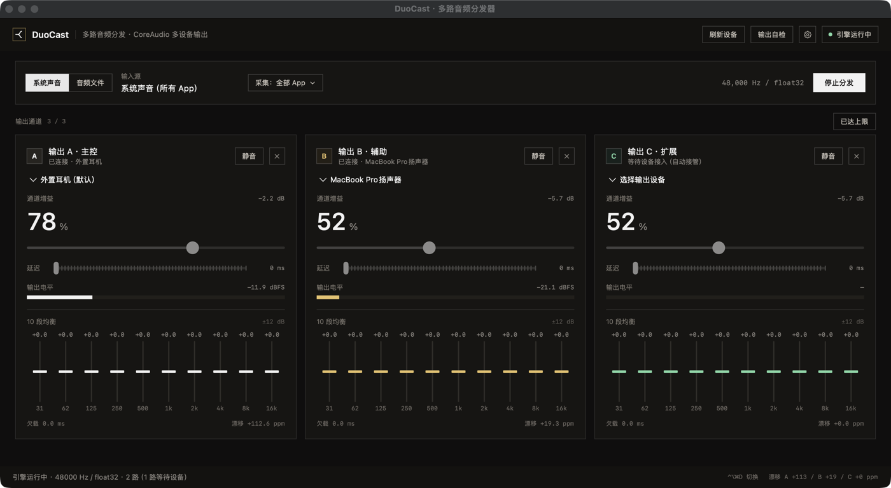

# DuoCast

**一台电脑，多副耳机，同一首歌。**



典型场景：一个人在电脑上放歌，两个人都想听，但只有一个耳机孔。DuoCast 把同一路声音同时送到 2–3 个输出端点，**每一路独立调音量、独立延迟补偿、独立 10 段均衡**——谁嫌吵就调谁，不用互相迁就。系统声音模式下还能**按 App 单独调音量**：把微信提示音调小，不影响正在放的歌。

目前 macOS 版可用（SwiftUI + CoreAudio），Windows 版是独立的 C# 实现，两边不共用 UI 框架：音频设备层本来就是平台专有的，强行统一只会让两边都难调试。

## 目录

- [它能做什么](#它能做什么)
- [安装](#安装)
- [使用](#使用)
- [命令行入口](#命令行入口)
- [它是怎么做到的](#它是怎么做到的)
- [配置文件](#配置文件)
- [能力边界：两副蓝牙耳机不能同时出声](#能力边界两副蓝牙耳机不能同时出声)
- [实测数据](#实测数据)
- [仓库结构](#仓库结构)
- [从源码构建](#从源码构建)
- [已知限制](#已知限制)
- [路线图](#路线图)

## 它能做什么

| 能力 | 说明 |
| --- | --- |
| **系统声音采集** | CoreAudio Process Tap，不装虚拟声卡、不改系统输出。任何 App 播放的声音都能分出去 |
| **本地文件输入** | 没有播放器、只想验证链路时用 |
| **2–3 路输出** | 每路一个独立 AUHAL 单元，各自按自己的设备时钟跑 |
| **每路独立参数** | 音量 0–120%、延迟 0–300 ms、10 段 EQ（31 Hz – 16 kHz，±12 dB） |
| **按 App 采集** | 只把选中的 App 分出去，系统提示音、微信提示音不会跟着跑 |
| **设备热插拔** | 插上耳机自动接管，拔掉只断那一路，其他继续放 |
| **参数按设备记忆** | 每副耳机记住自己的音量/延迟/EQ，换回来自动恢复 |
| **常驻控制** | 菜单栏图标、Dock 右键菜单、全局快捷键（默认 ⌃⌥⌘D，可改） |
| **锁屏自动停止** | 锁屏或休眠时停掉分发，唤醒不自动恢复 |

## 安装

从 [Releases](https://github.com/Meteorkid/duocast/releases) 下载 `DuoCast-x.y.z-macOS-arm64.zip`，解压后把 `DuoCast.app` 拖进「应用程序」。

**首次打开请右键 →「打开」**。这个构建是 ad-hoc 签名、未经 Apple 公证，直接双击会被 Gatekeeper 拦下。若提示「已损坏」：

```bash
xattr -dr com.apple.quarantine /Applications/DuoCast.app
```

系统要求：**macOS 14.2+**（Process Tap 的最低版本），当前构建为 **arm64（Apple Silicon）**。

首次点「开始分发」时，系统会要求「录屏与系统录音」权限——系统音频采集归在这个权限下。**拒绝不会报错，只是采到的全是静音**，界面会在 3 秒后给出提示。授权路径：系统设置 › 隐私与安全性 › 录屏与系统录音。

## 使用

1. **选输出设备**：每张卡片顶部的下拉里挑一个端点。默认会按「系统默认优先、互不重复」自动填好。
2. **选输入源**：左上角「系统声音 / 音频文件」。
3. **选采集范围**：系统声音模式下，点「采集：全部 App」可以选择只采某几个 App。
4. **点「开始分发」**，然后用任意 App 放歌。
5. **调参数**：每路可以单独改音量、延迟、EQ。这些值会记在**那台设备**名下。

### 延迟怎么调

蓝牙耳机有 100–200 ms 的固有延迟，有线几乎为零。所以延迟**要加在有线/内置扬声器那几路上**，把它们拖到和蓝牙一致；加在蓝牙上是越调越错。判断标准很简单：让同一个人同时听两副耳机，调到听不出先后。

### 关掉窗口之后

关窗口不退出应用——窗口只是控制面板。要从后台控制：

- **菜单栏图标**（运行时是实心双音箱，待机是空心）
- **Dock 图标右键** → 开始/停止、显示控制面板
- **⌃⌥⌘D**：全局快捷键，任何 App 在前台都有效；可在标题栏齿轮里改

## 命令行入口

不点界面也能跑，便于脚本化与排障（`DUOCAST_DEBUG=1` 时每秒往 stderr 打一行指标）：

| 命令 | 作用 |
| --- | --- |
| `--system` | 用系统声音作为输入并自动开始分发 |
| `--play <文件>` | 用本地文件作为输入并自动开始 |
| `--channels <1-3>` | 指定输出通道数 |
| `--tap-apps <id,id>` | 只采集这些 App（bundle ID 逗号分隔） |
| `--probe-outputs` | **端点自检**：逐个 / 同时打开所有端点，报告哪一个真的在拉数据 |
| `--close-window <秒>` | 自测用：N 秒后关掉窗口，验证「关窗不退出」 |

`--probe-outputs` 值得单独说：它判断的不是「单元能不能启动」，而是「HAL 有没有真的来拉数据」——蓝牙链路被系统挂起时单元照样启动，然后一次回调都不来，这正是「界面在跑、耳机没声」的成因。

## 它是怎么做到的

```
系统声音（Process Tap）┐
                      ├─▶ 交错立体声 float32 ─▶ 每路一个环形缓冲
本地文件（AVAudioFile）┘                              │
                        ┌─────────────────────────────┼─────────────────────────────┐
                        ▼                             ▼                             ▼
          通道 A: EQ → 增益 → 延迟 → AUHAL(设备 A)   通道 B: …                   通道 C: …
```

四个关键决定：

**1. 用 Process Tap，不用虚拟声卡。** BlackHole / Loopback 那类方案要求用户装驱动、再把系统输出切过去，任何一步错了就是「没声音，也不知道该修哪」。`AudioHardwareCreateProcessTap` 是系统 API（macOS 14.2+），采集点在进程混音之后、硬件输出之前，不需要安装任何东西。被采集的进程在读取期间静音（`muteBehavior = .mutedWhenTapped`），所以不会出现「系统原声 + 各路输出」三重播放；停止读取后自动恢复原声。

**2. 每路一个独立 AUHAL 单元，不共享时钟。** 48 kHz 耳机、96 kHz 内置扬声器可以同时跑，差别只在读步长。每路一个环形缓冲，一路卡住不影响其他路。

**3. 读步长同时承担重采样与漂移补偿。**

```
step = (源采样率 / 设备采样率) × (1 + 漂移修正)
```

插值读取本身就是重采样，不需要额外重采样器。漂移修正按**毫秒误差**定标（水位偏离目标 50 ms 给满量程 ±0.2%），按帧数定标会让控制器在块状喂数据下长期顶到饱和。

**4. 设备用 UID 认，不用 ID 认。** `AudioDeviceID` 插拔一次就会变，`kAudioDevicePropertyDeviceUID` 不会。参数记忆、热插拔接管都以 UID 为键；否则每次插拔都会丢掉那副耳机的设置。

更细的取舍（踩过的坑、被否掉的方案、每一步的实测数字）写在 [duocast-mac/README.md](duocast-mac/README.md) 里。

## 配置文件

`~/Library/Application Support/DuoCast/settings.json`，标题栏齿轮里有「打开存档位置」。

```json
{
  "channelCount": 3,
  "eqEnabled": true,
  "tapScope": "all",
  "tapBundleIDs": [],
  "hotKeyCode": 2,
  "hotKeyModifiers": 6400,
  "hotKeyLabel": "⌃⌥⌘D",
  "stopOnLock": true,
  "devices": {
    "BuiltInHeadphoneOutputDevice": { "volume": 78, "delay": 0,   "eq": [0,0,0,0,0,0,0,0,0,0] },
    "BuiltInSpeakerDevice":          { "volume": 52, "delay": 150, "eq": [0,0,0,0,0,0,0,0,0,0] }
  }
}
```

| 字段 | 含义 |
| --- | --- |
| `devices.<UID>` | 每台设备的音量 / 延迟 / EQ。UID 由系统给出（如 `BuiltInSpeakerDevice`），插拔不变 |
| `channelCount` | 上次用的通道数 |
| `tapScope` / `tapBundleIDs` | 采集范围：`all`，或 `apps` + bundle ID 列表 |
| `hotKeyCode` / `hotKeyModifiers` | 全局快捷键的物理键位与修饰键（Carbon 常量） |
| `stopOnLock` | 锁屏 / 休眠时是否自动停止 |

不记静音状态：静音是临时动作，下次启动突然没声音，人第一反应是「软件坏了」。

## 能力边界：两副蓝牙耳机不能同时出声

这是 macOS 的限制，不是本项目的实现问题：

> 蓝牙经典音频（A2DP）在一个控制器上只维持一路活动音频流。在系统里连上第二副耳机，第一副会被踢掉；用系统自带的「音频 MIDI 设置 › 多输出设备」结果一样。

先分清三件事——**配对**（系统记住了这副耳机）、**连接**（建立了链路）、**音频流**（A2DP 真的在传数据）。只有第三层才有声音。本机实测：6 副耳机已配对，可选输出端点里 0 副蓝牙。

可行的组合：

| 组合 | 说明 |
| --- | --- |
| 一副有线 + 一副蓝牙 + 内置扬声器 | 三路，已实测可用（插着 3.5 mm 时内置扬声器仍然发声，做过声学测量确认） |
| 一副有线 + 一副蓝牙 | 两路，最省事 |
| 两副都要无线 | 给第二副配一个 **USB 蓝牙音频发射器**：它在系统里是普通 USB 声卡，自己负责配对，不再受 A2DP 单路限制 |

不要按「LE Audio 协议支持多接收端」推断「系统能用」——这台机器的控制器报告支持 `LEA`，但 CoreAudio 没有把它暴露成可同时开多路的形式。

## 实测数据

| 场景 | 结果 |
| --- | --- |
| 系统声音输入，连续 11 秒 | 两路欠载 0.0 ms，漂移修正 +133→+82 / +35→+14 ppm（收敛未饱和） |
| 三路并发（48 k + 96 k + 重复设备） | 三路欠载均为 0.0 ms，C 与 A 漂移曲线重合（同设备同时钟） |
| 内置扬声器 vs 3.5 mm 并存 | 只向扬声器送测试音，麦克风 RMS 0.4131（环境底噪 0.0066），确认扬声器真的在响 |
| 热插拔接管 | 新端点出现后运行中自动接入，A/B 不中断；端点销毁后只断那一路 |
| 按 App 过滤 | 只采微信时 afplay 播放全程 0.0000；改采 `com.duocast.app` 时峰值 0.39–0.65 |

## 仓库结构

```
duocast/
├─ duocast-mac/          macOS 客户端（SwiftUI + CoreAudio），当前主力
│  ├─ Sources/DuoCast/   Audio/ 是引擎，UI/ 是界面
│  └─ README.md          实现细节、踩坑记录、每一步的实测数字
├─ duocast/              Windows 客户端（C# / .NET 8 / WPF / NAudio）
├─ beam/                 跨网络中转传文件的实验工具（Go），与本产品解耦
└─ docs/                 研究笔记：双机链路测量、AWDL 可行性、实验协议
```

## 从源码构建

需要 macOS 14.2+ 与 Xcode 命令行工具。

```bash
cd duocast-mac
./build.sh                 # 产物在 build/DuoCast.app
open build/DuoCast.app
```

`build.sh` 会做三件事：`swift build --disable-sandbox`（SwiftPM 默认给子进程套沙箱，受限环境里会直接报 `sandbox_apply: Operation not permitted`）、按模板写 `Info.plist`（版本号由 `DUOCAST_VERSION` 注入）、ad-hoc 签名。

## 已知限制

1. **两副蓝牙耳机不能同时出声**（见上）。
2. **通道上限 3**。每多一路就多一个实时 AUHAL 单元 + 一套 EQ + 一条重采样路径。
3. **增删通道会停止分发**——引擎的通道数组要重建。设备热插拔不受影响，能运行中接管。
4. **菜单栏图标可能不可见**：菜单栏右侧排满时系统会把状态项移到屏幕外（本机实测连续三个都落在负坐标）。Dock 菜单与快捷键不受影响。
5. **采集范围只认「正在使用音频的进程」**：选定 App 若当前没有任何音频进程对象，启动会直接报错而不是静默输出静音。
6. **环形缓冲用 NSLock 保护**，严格来说实时线程里不该有锁；50 ms 缓冲下三路实测零欠载，但更彻底的做法是每路一个无锁单生产者单消费者队列。

## 路线图

- [ ] 无锁环形缓冲替换 NSLock
- [ ] 增删通道不停分发
- [ ] 每台设备的 EQ 预设
- [ ] 按 App 采集时自动带上 Helper 进程（Chrome / Electron 类）
- [ ] 「闲置 N 分钟」也自动停止

## 许可证

暂未指定许可证，默认保留所有权利。如需复用请先联系作者。
