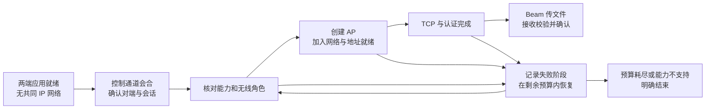

# Mac–Windows 无基础设施近距离传输研究计划

> 版本：v1，2026-11-02。用途：一篇论文的研究设计与执行准备。
> 用户已确认：12 周，目标为完成可投稿初稿；只有现有 Mac 与 Windows 各一台。每周 10–15 小时为尚可调整的工时假设，论文投稿准备程度以第 12 周证据与完整性检查为准。
> 配套文件：[实验方案与操作规程](experiment-protocol-2026-11-02.md)。本轮完成计划，尚未开始新增功能开发或正式实验。

## 1. 论文主线

**暂定中文题目：无基础设施条件下 macOS–Windows 近距离文件传输的建链与恢复机制。**

**暂定英文题目：Connection Establishment and Recovery for Infrastructure-Free Proximity File Transfer between macOS and Windows.**

核心问题：两台使用不同桌面操作系统的电脑，在没有共同 IP 网络时，如何利用自身无线能力完成首次会合、对端确认、数据链路建立和可靠文件传输，并控制失败恢复的时间成本？

论文按“小型系统机制研究＋实证评估”组织。Beam 提供已有 IP 网络上的传输数据面；研究集中于其前面的连接过程。初步方法是用平台实际状态推进连接阶段，在错误发生时选择必要的恢复步骤，并给整个尝试设置统一截止时间。

自适应链路选择暂列扩展：只有发现至少两条真实可用的数据路径，或两种具有实质成本差异的建链流程，才进入主方法。若只有 Windows 建 AP、Mac 加入这一条路径，研究采用固定角色，重点评估连接状态判断和恢复机制。

## 2. 研究边界与可用资源

| 项目 | 本计划范围 |
| --- | --- |
| 设备 | 一台 Apple Silicon Mac；Windows 为 Xiaomi Redmi Book 16 2024（用户标注 Gen12 CPU），Windows 11 家庭中文版 64 位 10.0.26200 / Build 26200，Intel Wi-Fi 6 AX203；驱动 23.60.1.2（2024-05-01），当前状态 Up。Windows 信息由用户提供，E0 保存原始盘点输出；Mac 完整型号/OS build 待补 |
| 网络 | 主实验开始时无外部路由器、互联网、以太网线或既有共同 IP 网络；Wi-Fi 和蓝牙保持开启 |
| 软件 | 两端可安装研究客户端；首次安装、授权与后续传输分别记录 |
| 交互 | 允许首次身份核验和操作系统要求的确认；如需人工加入网络，计入任务时间与操作数 |
| 文件 | 主实验每次传一个固定合成文件；1 MiB、100 MiB、1 GiB |
| 现有工具 | Beam 的 TCP 传输、加密、逐文件 SHA-256 校验及接收回执、UDP/mDNS 发现、基准工具 |
| 主指标 | 截止时间内完成率、从发起到接收校验确认的总时间、人工操作次数 |
| 研究范围 | 首次会合、建立本地链路、连接前故障恢复；无需新增网卡、手机、云中转或 AWDL 驱动 |
| 推广范围 | 结论首先适用于实测设备组合；跨设备兼容性需要额外设备证据 |

校园网跨子网实验可用于引入“发现能力与数据连通性不同”的现象。它不进入无基础设施主实验，也不与主实验混合汇总。

## 3. 已有证据与待验证环节

本地共有 15 条回环记录和 7 条校园网跨子网记录，均采用指定地址模式。它们表明已有网络上的传输实验已经开展；自动建链、BLE 跨系统控制消息、离线热点接入仍需实机验证。

当前基准的 `connect_ms` 测量 TCP 连接或中转配对，加密握手另在总时间内。`discovery_ms=0` 在指定地址模式表示没有执行发现。现有 `--size` 按 1024² 字节生成数据，历史 CSV 的 MB 标签实为 MiB；原始文件保留，正式实验使用精确字节数。

**接收确认复核：** `proto.Send` 内部的 `sendOne` 已等待逐文件 Result；接收端完成文件关闭、SHA-256 核对和重命名后才回 OK。因此单文件研究可沿用此确认点，并补充关联日志。若扩展多文件批次，再考虑批次 Complete 的最终 ACK。当前语义为应用层校验与保存完成，不包含断电持久化保证。

本地依据：[研究方向](research-directions.md)、[基准实现](../beam/cmd/beam/bench.go)、[传输协议](../beam/internal/proto/proto.go)、[统计脚本](../beam/scripts/bench-summary.py)、[校园网数据](../beam/bench-results/campus.csv)、[回环数据](../beam/bench-results/loopback.csv)。

## 4. 相关工作与差异核对

以下是一手资料的定向核查，访问日期为 2026-11-02。它们用于确定前两周的阅读和复现任务；尚不足以宣称完整研究空白。

| 工作 | 已有能力或结论 | 本研究需要进一步证明的差异 |
| --- | --- | --- |
| [Google Nearby Connections](https://github.com/google/nearby/blob/main/connections/README.md)，当前 README | 共同媒介发现/连接、交换媒介能力并升级到高带宽通道；macOS/iOS 构建段注明 Wi-Fi LAN 支持 | 发现与数据分离、能力交换本身已有先例。需要对具体桌面平台冷启动、阶段状态与恢复成本作机制比较 |
| [Microsoft Legacy AP 示例](https://learn.microsoft.com/en-us/samples/microsoft/windows-classic-samples/wifi-direct-legacy/)与[指南](https://learn.microsoft.com/en-us/windows-hardware/drivers/partnerapps/wi-fi-direct) | 支持的网卡/驱动可建立 Legacy AP，让普通 Wi-Fi 客户端加入；该路径不提供互联网共享 | 调 API 建 AP 是实现基础；科研价值须来自被揭示的失败条件和经过对照验证的解决机制 |
| [Apple Core Bluetooth](https://developer.apple.com/documentation/corebluetooth)及[蓝牙用途说明](https://developer.apple.com/documentation/bundleresources/information-property-list/nsbluetoothalwaysusagedescription) | 提供 BLE Central/Peripheral、发现和 GATT 交换等能力，涉及应用权限 | Mac↔Windows 双向消息、会话绑定、断线恢复与 Wi-Fi 接入仍需测试；广播可见不代表连接可用 |
| [ICE，RFC 8445](https://www.rfc-editor.org/rfc/rfc8445.html)，2018 | 候选交换、排序、连通性检查与提名；假设另有信令连接 | 可借鉴状态和候选管理；本题关注没有预先信令/IP 网络时的启动与链路创建 |
| [LocalSend 协议](https://github.com/localsend/protocol/blob/main/README.md)、[Feem](https://feem.io/en/pages/how-feem-works) | 已有跨平台本地传输；LocalSend 有组播和 HTTP 发现，Feem 使用共同 Wi-Fi/LAN | “跨平台离线传输”不能作为首创；产品按相同初始条件测试，不能用默认界面差异解释机制收益 |
| [NearDrop](https://github.com/grishka/NearDrop) | macOS 的 Nearby Share/Quick Share 部分实现，README 标明 Wi-Fi LAN | 协议适配已有先例；是否适合本设备对作为产品对照，应按其实际互操作支持决定 |
| Stute、Kreitschmann、Hollick：[One Billion Apples’ Secret Sauce](https://arxiv.org/abs/1808.03156)，MobiCom 2018 | 分析 AWDL 协议并研究同步、信道跳转及吞吐 | 用于理解生态接口边界；不将重新抓到 AWDL 帧视为本论文贡献 |

优先精读线索还包括 *Wi-Fi Direct Performance Evaluation for V2P Communications*（2020，[出版页](https://www.mdpi.com/2224-2708/9/2/28)）。本轮仅取得出版页索引内容，直接打开遇到限流；正式引用前需取得全文并核对方法，不能据检索摘要引用具体数值。

第 1–2 周完成一份约 12–20 项的差异表，检索三组关键词：`Wi-Fi Direct connection establishment group formation measurement`、`cross-platform proximity transfer Bluetooth Wi-Fi bootstrap`、`connection setup recovery capability constrained desktop`。每项记录对象、控制通道、数据路径、初始条件、恢复策略、评估指标与代码可用性。对“没有人做过”的判断要求逐项比对，不以搜不到代替新颖性证据。

## 5. 路线取舍

| 路线 | 产出与成本 | 本计划选择 |
| --- | --- | --- |
| A：仅测量和失败分类 | 开发量较小；一对设备容易成为局部案例，需解释有价值的机制现象 | 保留为前两周工作及后续论文证据；若方法无收益，重新评估是否能形成测量论文 |
| B：建链与有界恢复机制 | 可用同一数据面验证机制；依赖真实控制通道和系统接口 | **推荐主线**，先验证可行性，再建立强基线 |
| C：完整 AWDL 移植 | 涉及驱动/固件/硬件支持，超出现有设备与时间条件 | 本论文不安排 |

## 6. 研究问题、假设与贡献对应

| 研究问题 | 可检验假设 | 实验与判断 |
| --- | --- | --- |
| RQ1：当前设备能力能否支撑完整离线流程？ | 至少一条原生无线链路可完成会合或人工引导、IP 建立、双向校验传输 | E0 检查每一层；E2 验证首次会合。功能接通是可行性证据 |
| RQ2：阶段状态管理怎样影响完整任务成本？ | 在相同控制通道、认证语义和数据面下，验证状态有效性并保留可用进展，可在瞬态失效后减少无效重启；正常流程的额外开销同时测量 | E1 对比合理事件驱动的 B1 与 M；同方向、文件、初始状态配对分析。若相当，保留更简单流程 |
| RQ3：阶段相关恢复能否提高期限内完成率？ | 对已识别的连接前故障，仅恢复受影响阶段能减少整流程重启成本 | E3 对比 B1、M、M-no-recovery；自然故障与注入故障分别报告 |
| 扩展 RQ4：建链成本是否改变最优选择？ | 存在真实可选路径时，计入创建/切换成本的选择优于仅看带宽或固定优先级 | 通过 G2 后另行冻结扩展实验；当前主矩阵不预支这一贡献 |

**拟争取的三个贡献：**（C1）描述实测平台组合的可达状态与失败边界，映射论文第 3 节；（C2）给出可复现的建链与阶段恢复机制，映射第 4 节；（C3）用公平基线、冷启动及消融实验验证有效条件，映射第 5 节。贡献句在数据完成后按结果改写，不预填提升幅度。

## 7. 候选方法设计

### 7.1 模块与挑战

| 挑战 | 模块 | 可观察输出 |
| --- | --- | --- |
| 没有共同 IP 网络，双方对角色和能力缺少一致认识 | M1：首次会合与会话确认；优先验证原生 BLE 小消息通道 | 对端确认、能力快照、会话标识；不把扫描到名称当认证成功 |
| API 返回、AP 可见、客户端关联、地址就绪、TCP 可达不是同一时刻 | M2：基于实际状态的建链编排 | 各阶段事件、选定角色、地址可用和 TCP 确认 |
| 控制断连或 AP 启动失败会留下旧状态，整流程重试浪费已有进展 | M3：阶段恢复与统一截止时间 | 失败阶段、重试原因、保留/废弃的状态、恢复耗时和终态 |

M1 和基本就绪事件处理是共用实现基础。候选方法与主基线的区别应集中在状态有效性判定、保留/撤销已有进展及选择恢复阶段；调用现有 API 或补齐正确事件处理不单列为方法创新。

BLE 为待验证控制通道，不是既定成果。若 BLE 跨系统互操作失败，先保留人工交换临时网络信息的可行性流程，并评估系统 Wi-Fi 扫描是否提供更简单的会合方式。不得将依赖第三台手机扫码或公网服务器的方案计入主场景。

Windows 建 AP、Mac 作为普通 Wi-Fi 客户端是首选验证路径；文件发送方向可以反转，无须反转 AP 角色。只有真实验证 Mac 也能在当前条件下提供 AP，才增加角色选择。

首次核验与临时网络凭据交换应绑定同一应用会话。BLE 设备名、SSID 和“距离近”均不作为身份依据。采用已有认证机制，研究不新增密码算法。已配对冷启动与首次陌生设备会合的信任状态分别记录。

### 7.2 最简单可实现的决策规则

1. 先读取本次实际能力与权限状态，再决定是否尝试建链；不支持时明确返回原因。
2. 在已验证的能力组合中采用固定角色；不为只有一个候选的情况引入评分器。
3. 从“控制已确认→AP 已就绪→关联成功→地址就绪→TCP 就绪→认证成功”逐阶段推进。可并行的事件记录区间，不用相加方式伪造总耗时。
4. 对可恢复错误最多进行一次恢复尝试；恢复动作、阶段预算在预实验后统一冻结。所有自动基线享有相同总时间和恢复次数预算。B1 同样正确等待系统就绪事件，按固定流程建立连接并在必要时整体重试；M 根据有效状态选择恢复起点。
5. 失去 AP/关联状态时撤销过期地址；只有控制通道断开、而数据通道仍有效时，不默认拆除可用数据链路。
6. 成功终点取接收端逐文件校验确认。不可恢复错误和预算耗尽都有明确终态。

扩展策略只有在两条路径可用时考虑估计 `setup_cost + payload_bytes / goodput + expected_recovery_cost`，估计值来自独立探索数据。该公式是决策模型起点，必须与固定规则比较，不能以公式本身充当创新。

## 8. 实验总览

| 编号 | 目的 | 规模 |
| --- | --- | --- |
| E0 | 能力检查、人工离线建链与双向控制消息 | 每个可行候选流程 10 次探索，至少两个时段 |
| E1 | 已配对冷启动主比较 | 3 方法 × 2 方向 × 3 文件规模 × 20 次＝360 次 |
| E2 | 首次会合与身份确认成本 | 3 方法 × 2 方向 × 100 MiB × 10 次＝60 次 |
| E3 | 阶段恢复及消融 | 3 方法 × 2 故障 × 1 方向 × 100 MiB × 10 次＝60 次 |
| E4 | 已建链的传输成本参考 | 1 个共享数据面 × 2 方向 × 3 文件规模 × 5 次＝30 次 |

正式候选矩阵共 510 次，E0 和调试探索另计。若每次重置加操作平均 2–3 分钟，操作约 17–26 小时，超时和排障另外计算。第 5 周依据实测耗时决定是否缩减大文件扩展，正式冻结后不根据结果删条件。详细步骤、超时、样本分组和日志字段见配套实验方案。

## 9. 12 周执行安排

| 周次 | 工作 | 可检查交付物 |
| --- | --- | --- |
| 1 | 设备/权限盘点；阅读直接先验；运行官方路线的最小验证准备 | 能力表、文献差异表初版、初始条件清单 |
| 2 | E0：Windows AP→Mac 加入；双向文件；BLE 小消息互通 | 原始日志、失败原因、G1 决策 |
| 3 | 最小测量改造：阶段事件、关联 ID、字节单位、截止时间、逐次记录 | 测量验收记录；历史数据标识为探索集 |
| 4 | 实现 B1 与 M 的最小共用原型；保留相同传输和认证路径 | 可复现状态机、明确的策略差异、功能验证 |
| 5 | 小规模探索；验证故障是否存在、模块是否必要、人工基线成本 | 每个关键条件约 3–5 次探索；G2 决策与运行预算 |
| 6 | 修正测量、冻结正式实验协议及软件版本 | 冻结的矩阵、随机顺序、期限、分析规则、文件哈希 |
| 7–8 | E1、E2，分日期和时段执行 | 全部试次状态与两端日志、每批次完整性检查 |
| 9 | E3、E4；处理预先规定的技术无效试次 | 消融/恢复数据；独立于探索集的正式数据集 |
| 10 | 统计、归因、相关工作补查 | 完成率曲线、阶段时间、失败表；结论与证据对应表 |
| 11 | 写引言、方法、实验、适用范围 | 一篇完整初稿，按已取得结果确定主张 |
| 12 | 从原始数据重建图表；交叉核查；修改论文 | 修订初稿、复现说明、数据字典、实验包目录 |

工时目标约 120–180 小时。若每周可用时间更少，优先保留 RQ1–RQ3，删除 RQ4、产品大范围横评、能耗和额外平台；正式次数的调整在预实验后、看正式结果之前完成。

## 10. 三个阶段判断点

**G1a，第 2 周：数据链路是否可行。** 至少一次完整离线双向校验传输，并跨两个时段完成 10 次流程尝试；记录失败而非只数成功。10 次用于探索，不用于宣称高可靠性。如果原生 API/硬件无法提供任何适用链路，暂停自动化实现，保留能力与失败证据，重新讨论硬件约束或题目范围。负结果是否值得成文需要单独判断。

**G1b：控制通道及其与数据链路共存是否可行。** 双向小消息、断开重连及 AP 建立期间的行为均有记录后，才进入依赖该通道的 B1/M 自动会合实现。只通过 G1a 时继续人工引导流程测量；若采用双方一致的人工前置步骤，需先冻结半自动版本并调整 RQ 与 E3 故障定义，不能继续声称已自动会合。AX203 的型号和适配器 Up 状态不能代替 Legacy AP、GATT 与跨系统接入验证。

**G2，第 5 周：是否存在需要研究的机制问题。** 固定自动流程与 M 的条件必须相同；至少有一类可复现的等待、状态失配或恢复问题，能解释 M 为什么值得保留。如果 B1 已同样可靠、同样快，则合并或删除 M 的额外模块；不靠增加不必要条件创造优势。若没有真实路径选择空间，删除“自适应选路”贡献。

同时检查机制是否超出已有事件驱动状态机、常见重试和恢复实践。若收益来自纠正固定等待、错误状态处理等基础实现问题，记为工程修复；只有与合理事件驱动基线相比仍存在可解释的机制差异，才冻结方法贡献。

**G3，第 10 周：数据支持什么论文。** 若机制收益在预先指定条件成立，写机制与边界；若仅获得新测量现象，评估其解释力后调整为测量稿；若现象与方法都缺乏实质差异，保留工程成果并重新选题。论文投稿档次和去向由实际证据、导师意见与当期征稿要求决定。

## 11. 论文结构与预期图表

1. Introduction：具体使用场景、已有方案的适用条件、本研究问题与经验证的贡献。
2. Background and Related Work：Nearby/ICE/Legacy AP/AWDL，以及最接近的建链和恢复研究。
3. Problem and Measurement：初始状态、能力边界、E0 发现、任务和成功定义。
4. Design and Implementation：M1 会合确认、M2 状态推进、M3 有界恢复；解释每一模块由哪个故障或约束产生。
5. Evaluation：RQ1–RQ3，按主比较、首次会合、恢复消融和适用范围组织。
6. Discussion and Conclusion：已支持的主张、设备组合范围、尚需验证的推广条件。

建议 4 张核心图和 2 张表：图 1 场景与状态链；图 2 全试次完成率随时间变化；图 3 关键阶段时间与配对差值；图 4 恢复消融；表 1 设备/能力与初始状态；表 2 失败原因和适用边界。文件规模分面，避免把 1 MiB 与 1 GiB 汇成一个吞吐排名。

逻辑检查：平台能力与启动条件限制对应 M1；异步就绪对应 M2；可复现连接故障对应 M3。各模块均有实验对应。最终新颖性和方法收益仍由第 1–5 周核对及正式实验决定；若某挑战没有观测依据，删去相应模块和贡献。

## 12. 第一周就做这五件事

1. 保存用户已提供的 Windows 硬件信息对应的原始输出；补齐 Mac 版本和无线能力，命令见实验方案。先保留 AX203 驱动 23.60.1.2 作为探索基线；若之后确需升级，记录原因并建立新的软件/驱动条件。
2. 读 Nearby README、Microsoft Legacy AP 指南和官方样例；把能确定的要求与尚需实测的行为分开写。
3. 定义并拍下“无共同网络但无线已开启”的初始状态；确认实验期间不会借助 VPN、校园网或中转路径。
4. 准备官方 Legacy AP 样例的编译/运行条件，人工建立网络后用现有 Beam 传一个 1 MiB 测试文件，再反向传；记录接收校验结果。
5. 做 BLE 双向小消息能力验证；先验证可交换消息、断开与重连，再考虑与热点流程结合。

本目录和 `beam/` 当前均未检测到 Git 仓库，也没有项目级 AGENTS.md。本轮不初始化 Git 或改变配置。若后续正式开发，可确认后加入一个简短 AGENTS.md，规定：研究主目录为 `beam/`、音频工程不联动修改、原始实验数据只追加不覆盖、构建与真机验收分别记录、提交需用户确认。
