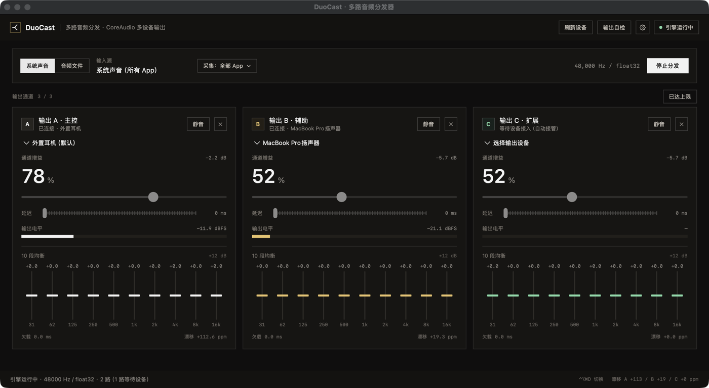

# DuoCast for macOS



同一路音频同时送到多个输出设备，每一路各自独立的音量、延迟与 10 段均衡。

这是原生 macOS 版本：SwiftUI 界面 + CoreAudio 多输出（每路一个 AUHAL）+ CoreAudio Process Tap 采集系统音频。与仓库里的 Windows 版（C# / WPF / NAudio）并列为两个独立工程——音频设备层本来就是平台专有的，强行共用一套 UI 框架得不到复用，反而让两边都难调试。

**当前状态**：可运行。两种输入源（系统声音 / 本地文件）均在本机实测通过；通道数可由界面增减，默认 2 路、上限 3 路（有线 + 蓝牙 + 内置扬声器），三路并发实测零欠载。

---

## 1. 与 Windows 版的差异

| 项 | Windows（duocast/） | macOS（本目录） |
| --- | --- | --- |
| UI | WPF (XAML) | SwiftUI |
| 音频输出 | NAudio `WasapiOut`，每路一个渲染流 | CoreAudio `AUHAL`（`kAudioUnitSubType_HALOutput`），每路一个 AudioUnit |
| 通道数 | 2 | 默认 2，可增删，上限 3 |
| 系统音频采集 | WASAPI 回环，**原声会再放一遍**，必须配 VB-CABLE | CoreAudio Process Tap（`AudioHardwareCreateProcessTap`），不需要虚拟声卡；采集期间由 tap 静音源进程，不重复出声；可只采指定 App |
| 输入源（当前） | 系统音频 / 采集设备 / 本地文件 | 系统声音 / 本地文件 |
| 虚拟端点 | 无此概念 | 必须过滤掉 `transport == virtual` 的系统端点，否则绑定会卡死（见第 5 节） |
| 设备热插拔 | 3 秒轮询 | `AudioObjectAddPropertyListenerBlock`，350 ms 去抖，运行中直接接管 |

---

## 2. 目录结构

```
duocast-mac/
├─ Package.swift                 SwiftPM 可执行目标（macOS 14.2+）
├─ build.sh                      打包成 build/DuoCast.app
├─ AppIcon.icns                 应用图标（由 scripts/make-icon.sh 生成，改设计别手改它）
├─ scripts/
│  ├─ make-icon.swift           用 CoreGraphics 画 1024 底图
│  └─ make-icon.sh              缩成十档尺寸并打包成 .icns
└─ Sources/DuoCast/
   ├─ DuoCastApp.swift           @main + 激活策略
   ├─ AppModel.swift             界面 ↔ 引擎的桥，20 Hz 指标刷新，输出通道增删
   ├─ AudioDeviceWatcher.swift   端点增删 / 默认输出变更监听，350 ms 去抖
   ├─ AudioProcesses.swift       HAL 音频进程枚举，按 App 采集的进程对象解析
   ├─ DeviceSettingsStore.swift  按设备 UID 记忆音量/延迟/EQ，JSON 持久化
   ├─ MenuBar.swift              菜单栏状态项、Dock 菜单、全局快捷键（Carbon）
   ├─ OutputProbe.swift          `--probe-outputs` 自检：端点有没有真的在拉数据
   ├─ Theme.swift                与 Windows 版共用的色板
   ├─ Log.swift                  DUOCAST_DEBUG=1 时才输出
   ├─ Audio/
   │  ├─ AudioDevices.swift      HAL 端点枚举、传输类型、默认设备
   │  ├─ OutputChannel.swift     AUHAL 输出单元 + 环形缓冲 + 增益 + 漂移补偿
   │  ├─ TenBandEQ.swift         10 段 RBJ peaking biquad（与 C# 版同参数）
   │  ├─ StereoRing.swift        交错立体声环形缓冲 + 线性插值
   │  ├─ FileSource.swift        AVAudioFile 解码 + 按真实时间喂数据
   │  ├─ SystemTapSource.swift   系统音频采集（Process Tap + 私有聚合设备）
   │  └─ AudioEngine.swift       一路输入 → 多路输出（文件 / 系统声音两种源）
   └─ UI/
      ├─ ContentView.swift       标题栏 / 输入源 / 状态栏
      ├─ ChannelCard.swift       单个通道卡（设备、音量、电平、10 段 EQ）
      └─ Controls.swift          按钮样式、标记、竖向 EQ 滑块
```

---

## 3. 构建与运行

```bash
cd duocast-mac
./build.sh            # 默认 release，产物在 build/DuoCast.app
open build/DuoCast.app
```

> `swift build` 需要 `--disable-sandbox`：SwiftPM 默认会给子进程再套一层沙箱，
> 在受限环境里会直接报 `sandbox_apply: Operation not permitted`。`build.sh` 已带该参数。

自测时可以让它自动选择输入源并开始分发，省掉手点：

```bash
# 文件输入
DUOCAST_DEBUG=1 ./build/DuoCast.app/Contents/MacOS/DuoCast --play /path/to/file.aiff

# 系统声音输入（随后用任意 App 播放声音即可）
DUOCAST_DEBUG=1 ./build/DuoCast.app/Contents/MacOS/DuoCast --system

# 三路：有线 + 蓝牙 + 内置扬声器（先连好蓝牙耳机）
DUOCAST_DEBUG=1 ./build/DuoCast.app/Contents/MacOS/DuoCast --channels 3 --system

# 只采指定 App（bundle ID 逗号分隔）
DUOCAST_DEBUG=1 ./build/DuoCast.app/Contents/MacOS/DuoCast --tap-apps com.apple.Music --system

# 输出端点自检：逐个 / 同时打开所有端点，看 HAL 有没有真的来拉数据
./build/DuoCast.app/Contents/MacOS/DuoCast --probe-outputs

# 验证「关窗不退出」：2 秒后关掉窗口，看进程是否还在
DUOCAST_DEBUG=1 ./build/DuoCast.app/Contents/MacOS/DuoCast --system --close-window 2
```

`DUOCAST_DEBUG=1` 时每秒往 stderr 打一行指标（两路电平、欠载、漂移、是否采到声音），可作为脚本化回归的断言出口。

---

## 4. 系统音频采集（产品主路径）

产品要成立，「听同一首歌」就不能要求用户先把歌下载成文件。所以输入源默认是系统声音：任何 App（Apple Music、Spotify、Safari、YouTube…）播放的声音都送进两路。

**为什么用 Process Tap 而不是虚拟声卡**（BlackHole / Loopback / Soundflower）：虚拟声卡要求用户装驱动、再把系统输出切过去，任何一步错了就是「没声音，也不知道该修哪」。Process Tap 是系统 API（macOS 14.2+），采集点在进程混音之后、硬件输出之前，不装任何东西。

实现上有三个要害：

1. **必须把 DuoCast 自己排除在采集之外**。否则输出到两路设备的声音会被自己再采一遍，形成自激啸叫。排除依据是进程的 `AudioObjectID`（通过 `kAudioHardwarePropertyTranslatePIDToProcessObject` 用 PID 换取），不是 PID 本身。
2. **`muteBehavior = .mutedWhenTapped`**。被采集的进程在 tap 被读取期间不再向硬件出声，避免「系统默认设备原声 + DuoCast 两路」三重播放；一旦停止读取（停止分发、退出、崩溃），系统自动恢复原声，不会让整机哑掉。
3. **私有聚合设备承载 tap**。`kAudioAggregateDeviceIsPrivateKey = 1` 让这个聚合设备只在进程内可见，不污染用户的设备列表；`kAudioAggregateDeviceTapListKey` 里的 sub-tap `uid` 必须等于 `CATapDescription.uuid`，对不上会创建失败。未启用 `kAudioAggregateDeviceTapAutoStartKey`——那会让 `AudioDeviceStart` 等第一段音频到来，没有声音时启动流程就卡在那里。

**权限**：系统把这类采集归到「录屏与系统录音」。授权被拒时 `AudioHardwareCreateProcessTap` 往往仍然返回成功，只是拿到的数据全是数字静音——这是最难排查的一种失败。界面的做法是：运行 3 秒后若采集到的仍是全零，状态栏转成警告色并给出授权路径。

> 开发期注意：`build.sh` 用的是 ad-hoc 签名，每次重新打包二进制哈希都会变，系统可能要求重新授权一次。正式发布需要 Developer ID 签名 + 公证，这个反复授权的问题才会消失。

---

## 5. 数据流

```
AVAudioFile ─────────┐
                     ├─▶ 交错立体声 float32 ─▶ 每路一个环形缓冲（源采样率）
Process Tap ─────────┘                            │
                    ┌─────────────────────────────┼─────────────────────────────┐
                    ▼                             ▼                             ▼
   通道 A: EQ → 增益 → 延迟 → AUHAL(设备 A)   通道 B: …                     通道 C: …
```

每一路都是独立的 AUHAL 单元，各自按自己的设备时钟拉数据，互不影响：A 是 48 kHz 耳机、B 是 96 kHz 内置扬声器、C 是 44.1 kHz 蓝牙，都能同时跑——差别只在读步长。

### 5.1 设备变化时的接管

插拔耳机、蓝牙连断、系统默认输出切换都会触发 `kAudioHardwarePropertyDevices` / `kAudioHardwarePropertyDefaultOutputDevice`。`AudioDeviceWatcher` 收这两个通知，做 350 ms 去抖（插一次耳机会连发好几条：端点出现 → 默认切换 → 流格式就绪），再交给 `AppModel.handleDeviceChange`。

处理规则：

1. **掉线的那一路立即断开，其余通道继续**。拔掉一副耳机不该让另外两个人也听不了——每路都是独立 AUHAL 单元，本来就互不牵连。
2. **空槽位自动接住新设备**，且是运行中直接接入（`AudioEngine.attach`），不打断正在播的分发。设备排序把「系统默认」放前面：蓝牙耳机连上时系统通常立刻把它设为默认输出，于是空槽会优先接住它。
3. **一轮通知里既有掉线又有新增**（蓝牙从 A 耳机切到 B 耳机）时，先断后接。

设备比槽位少时槽位**留空**，不重复绑定同一端点——重复绑定只会让声音在同一副耳机里叠一遍，没有意义；留空的位置正好是自动接管的落点。

> 有一个噪声源要挡掉：系统声音采集用的私有聚合设备也会触发同一批通知，但它不出现在可见设备列表里。所以接管逻辑先比对前后列表，没有任何增删、也没有空闲设备就直接返回，否则状态栏会被刷成「设备列表已更新」。

### 5.2 参数按设备记忆

接管只解决了「声音从哪出」，还差一半：**参数得跟着设备走**。蓝牙耳机和内置扬声器的响度、固有延迟差 100–200 ms，如果参数只挂在槽位上，每换一副耳机都要重调一遍延迟，自动接管的好处又还回去了。

存档在 `~/Library/Application Support/DuoCast/settings.json`：

```json
{
  "channelCount": 3,
  "eqEnabled": true,
  "devices": {
    "BuiltInHeadphoneOutputDevice": { "volume": 33, "delay": 150, "eq": [6,0,0,0,0,0,0,0,0,0] },
    "BuiltInSpeakerDevice":          { "volume": 47, "delay": 220, "eq": [0,0,0,0,0,0,0,0,0,0] }
  }
}
```

三个设计决定：

1. **键用 `kAudioDevicePropertyDeviceUID`，不用 `AudioDeviceID`**。后者插拔一次就会变（本机同一个 3.5 mm 口昨天是 107、今天是别的值），拿它做键等于每次都重建一份记录。
2. **只有 `loadedUID` 变化才重新加载**。指标每 50 ms 刷新一次，无条件套用存档会把用户正在拖的滑杆拽回去。
3. **不记静音状态**。静音是临时动作；下次启动突然没声音，用户第一反应是「软件坏了」。音量/延迟/EQ 才是「这台设备本来该怎么响」的属性。

第一次见到的设备没有存档，就以槽位当前值作初值写进去——「先调后记」和「先记后调」最后落到同一个状态。

### 5.3 只采指定的 App

> **2026-11-04 变更**：「选定 App」现在改为每 App 一个 tap、各自增益（见 5.4）。
> 本节描述的混音 tap 仍用于「全部 App」模式，进程对象那套解析逻辑两者共用。

默认是整机混音，但两个人戴着耳机听歌时，微信提示音、系统音效也会一起分出去。所以采集范围可选：「全部 App」或「选定 App」（多选，存在 `tapScope` / `tapBundleIDs`）。

**实现上走的是进程对象，不是 `bundleIDs`**，这一条是实测出来的：

| 做法 | 结果 |
| --- | --- |
| `CATapDescription.bundleIDs = ["com.duocast.app"]`，进程列表留空（macOS 26+） | **采不到**。被采对象峰值 0.17–0.28，采集端全程 0.0000 |
| `initStereoMixdownOfProcesses:` 传 HAL 进程对象 ID | **可用**。同一场景峰值 0.39–0.65 |

所以流程是：`kAudioHardwarePropertyProcessObjectList` 枚举进程 → 按 `kAudioProcessPropertyBundleID` 匹配 → 拿对象 ID 建 tap。界面上按 bundle ID 归并（Chrome 的 Helper、WebKit 的 GPU 进程会合成一条），名字取最短的那个，播放状态取「任一进程在跑」。

**必须排除自己**。选定模式同样要减掉本进程的 `AudioObjectID`：用户可能选中一个和自己同 bundle 的 App（或者干脆就是 DuoCast 自己），不排除会立刻自激——本机实测峰值 4 秒内从 0.55 飙到 344。

如果选定的 App 当前没有任何音频进程对象（没运行过、或被系统清掉了），启动会直接报错而不是静默失败：

> 选定的 App（com.example.nonexistent）当前没有音频活动，采不到声音。请先让它播放，或把采集范围改回「全部 App」。

读步长同时承担两件事：

```
step = (源采样率 / 设备采样率) × (1 + 漂移修正)
```

所以「文件是 22.05 kHz、A 设备 48 kHz、B 设备 96 kHz」这种组合是天然支持的——不需要额外的重采样器，插值读取本身就是重采样。

漂移修正按**毫秒误差**定标：水位偏离目标 50 ms 给满量程 ±0.2%，2 ms 只给 8 ppm。之前按帧数定标（`err × 2e-4`）会让控制器在块状喂数据下长期顶在 ±2000 ppm 饱和，界面上看着像坏了。

### 5.4 每 App 独立音量

「选定 App」不再把它们混成一路再整体调音量，而是**每个 App 一个 tap、各自增益后求和**。
界面在采集范围下方出现「每 App 音量」条，拖动即时生效，不重启分发。

**音量口径**：0–120% 线性，100% = 0 dB，与输出通道的 `volume` 同一套定义。
两级增益相乘后可能超过满刻度，混合级做硬限幅并计数——削波计数持续增长说明这一路给大了。

**为什么能只用一个聚合设备**：一条 tap 只能承载一个混音结果，要独立音量就必须一 App 一 tap。
关键问题是多个 sub-tap 能否在同一聚合设备里拿到彼此独立的 buffer。本机实测：

| 观察点 | 结果 |
| --- | --- |
| 静态流配置 `kAudioDevicePropertyStreamConfiguration` | `mNumberBuffers` 等于 sub-tap 数，每个 2 声道 |
| IOProc 内的 `AudioBufferList` | 同上，各路分属不同 buffer，互不混合 |
| buffer 顺序 | 严格跟随 `kAudioAggregateDeviceTapListKey` 的传入顺序（正序/反序对照） |

于是整个混音只要一个 IOProc：按 buffer 索引施加各自增益 → 求和 → 限幅。
单时钟、无跨设备漂移、无额外 mixer 线程。增益精度实测（`Spike/AppMixProbe.swift`，单槽位）：

| 设定 | 理论衰减 | 实测 |
| --- | --- | --- |
| 1.00 | 0 dB | +0.00 dB |
| 0.50 | −6.02 dB | −6.02 dB |
| 0.25 | −12.04 dB | −12.04 dB |

**与「全部 App」互斥**：两种模式各建一套采集，同时开会把同一进程采两遍、静音行为叠加。
所以音量条只在「系统声音 + 选定 App」时出现。

**共享进程不能按 App 对待**。`com.apple.WebKit.GPU` 是所有 WebKit 应用共用的承载进程，
按 bundle ID 分组会把 Safari 的视频和有道的发音混成一路；`audiomxd` 这类则根本不对应用户 App。
现在它们被单独标注（「网页音频」「系统音频守护」），副标题写明"多个 App 共用，无法单独区分"。
名单是实测整理的，见 `AudioProcesses.sharedNames` / `systemNames`。

**「正在播放」不能看 HAL 的 IsRunning**。`kAudioProcessPropertyIsRunning` 只说明进程挂着音频 IO：
本机实测 `dev.xisland.app` 该字段为真，采集到的却是恒定的数字静音。所以字段改名 `hasAudioIO`
（只用于排序），真正有没有声音由混音器在**增益之前**采到的峰值判断；界面绿点与电平条都取自该峰值。

命令行自检，不需要界面：

```bash
.build/debug/DuoCast --mix-apps com.apple.Music=0.5,com.apple.WebKit.GPU=1.0 --mix-seconds 8
```

三条判据：采集到非静音 / 输出持续出帧 / 运行中改音量不断流。

### 5.5 三层音量，别在同一处找

同一路声音要穿过三层增益才到耳朵，三层是**相乘**关系：

| 层级 | 在哪里调 | 作用范围 |
| --- | --- | --- |
| 每 App 音量 | 界面顶部「每 App 音量」 | 只影响那一个 App，与输出设备无关 |
| 通道增益 | 输出通道卡片的「通道增益」滑块 | DuoCast 送给这一路的声音 |
| 设备音量 | 输出通道卡片的「设备音量」滑块 | **该设备上的一切声音**；系统面板只列默认设备，调不到其余几路 |

**设备音量这一层是后来补的入口**（2026-11-04）。系统「声音」面板只列出当前默认输出设备，
另外几路根本不在列表里——想调它们得先设成默认、调完再切回来。卡片上的「设备音量」直接读写
`kAudioDevicePropertyVolumeScalar`，省掉这趟往返。可写性实测：写 0.35 后读回 0.3500。
不支持硬件音量控制的设备（部分聚合 / 虚拟端点）显示「—」并禁用滑块。

第三层最反直觉：**系统面板里没有非默认设备，也调不到它们。**
DuoCast 把音频直接送进每个物理设备，不走「默认输出」这条路由，所以另外几路在系统面板里根本不存在。
要调它们只能回到对应的通道卡片——这也解释了为什么有人把系统音量拉满，另一副耳机还是没声。

**一次实测的误判**（2026-11-04）：外置耳机 82%、MacBook Pro 扬声器 19%，源信号约 −24 dBFS。
19% 等于 −14 dB，相乘后输出约 −38 dBFS，笔记本扬声器上基本听不出来。
当时先怀疑「插耳机后系统把扬声器静音了」，查下来 `mute=0`、渲染回调正常、零欠载——**纯粹是增益太低**。

听不到某一路时的排查顺序：

1. 那一路的**通道增益**是否低于 35%（低于该值时大号数字会变黄）；
2. 「每 App 音量」里对应的 App 是否被拉低——只在「选定 App」模式下存在；
3. 系统面板只覆盖默认设备，别在那里找其余几路；
4. 以上都正常再看电平表：回调在跑但电平为 0，才轮到查采集侧。

---

## 6. 实测踩到的坑（都已修）

1. **`AudioBufferList.allocate(maximumBuffers:)` 会断言崩溃**（启动即 SIGTRAP）。改为按 `AudioObjectGetPropertyDataSize` 返回的确切字节数自己分配内存，再交给 HAL 填写。
2. **系统虚拟端点会卡死**。macOS 26 上存在 `transport == virtual` 的端点（Background Music、Audiojingle），它们有输出通道但不是播放设备；把 AUHAL 绑上去会永久卡在 `AudioUnitSetProperty`。现在枚举时按传输类型过滤，`OutputChannel.start` 里再兜一层。
3. **`AVAudioFile.read` 在文件末尾抛 `nilError`**，不是返回 0 帧。循环播放必须在读之前判断 `framePosition >= file.length`，否则会把「正常播完」当成解码失败。
4. **Process Tap 拿到的缓冲可能是非交错的**（每声道一个 buffer），而环形缓冲只吃交错立体声。现在按 buffer 数量分支，非交错时交织到复用暂存区再写入；单声道源复制成左右两声道。

另外两个数值层面的问题：欠载计数原本按**输出帧**统计却除以**源采样率**（96 kHz 设备上放大 4.35 倍）；缓冲目标 10 ms 配 11.6 ms 的喂数据粒度必然抽干，现默认 50 ms。

---

## 7. 实测结果

### 7.1 本地文件输入

`say` 生成的 22.05 kHz 单声道 AIFF，A = 外置耳机（48 kHz），B = MacBook Pro 扬声器（96 kHz），循环播放。

| 指标 | 结果 |
| --- | --- |
| 两路电平 | 有信号，A −6.7 dBFS / B −18.3 dBFS（B 音量 52%） |
| 累计欠载 | A 0.0 ms / B 0.0 ms |
| 漂移修正 | A +168 ppm / B +134 ppm（满量程 ±2000 ppm） |

### 7.2 系统声音输入

`afplay` 播放一段 `say` 生成的长句，A = 外置耳机（48 kHz），B = MacBook Pro 扬声器（96 kHz），连续运行约 11 秒。

| 指标 | 结果 |
| --- | --- |
| 采集格式 | 48 kHz / 2 ch / float32（系统全局混音） |
| 两路电平 | A 峰值 0.17–0.36 / B 峰值 0.10–0.20（B 音量 52%） |
| 累计欠载 | A 0.0 ms / B 0.0 ms |
| 漂移修正 | A +133 → +82 ppm / B +35 → +14 ppm（收敛，未饱和） |
| `sysAudio` 标志 | 音频开始后 1 秒内由 no 转 yes |

### 7.3 三路并发

`--channels 3 --system`，输入为系统声音，A = 外置耳机（48 kHz，3.5 mm）、B = MacBook Pro 扬声器（96 kHz）、C = 外置耳机（同一设备，用于验证第三路单元）。

| 指标 | 结果 |
| --- | --- |
| 三路电平 | A 0.16–0.55 / B 0.07–0.35 / C 0.07–0.37（B、C 音量 52%） |
| 累计欠载 | A 0.0 / B 0.0 / C 0.0 ms |
| 漂移修正 | A +99…+116 / B +17…+25 / C +99…+116 ppm |

同一条音频扇出到三路实时单元没有额外抖动；C 与 A 漂移曲线几乎重合，正是「同一设备、同一时钟」应有的表现。

### 7.4 内置扬声器能否与 3.5 mm 耳机同时出声

结论：**能**。这不是想当然——很多 Mac 在插入耳机时会物理断开扬声器，所以做了声学实测。

方法：把 440 Hz 测试音**只**送到「MacBook Pro 扬声器」这一个端点，用内置麦克风录 2 s 测 RMS；对照组把同一测试音送到「外置耳机」。

| 条件 | 麦克风 RMS | 峰值 |
| --- | --- | --- |
| 环境底噪（无测试音） | 0.0066 | 0.031 |
| 测试音 → 内置扬声器（音量 0.9） | **0.4131** | 0.695 |
| 测试音 → 外置耳机（音量 0.9） | 0.0295 | 0.586 |

送扬声器时 RMS 比底噪高约 35 dB，说明声音确实从机身发出而不是从耳机漏出。所以「有线 + 蓝牙 + 内置扬声器」三路在物理层成立。

### 7.5 热插拔自动接管

物理插拔不好脚本化，所以用「临时创建一个可见聚合设备、6 秒后销毁」制造真实的端点增删事件（`AudioHardwareCreateAggregateDevice` / `Destroy`，子设备指向「外置耳机」）。三槽位、A/B 已占用、C 空置，系统声音输入播放中：

| 阶段 | 日志 | 指标 |
| --- | --- | --- |
| 运行中，C 空置 | — | C 峰值 0.0000 / 漂移 +0 ppm（不误报"无数据流"） |
| 新端点出现 | `已自动接管 C → DuoCast 热插拔测试` | C 峰值 0.2513 / 漂移 +130 ppm，**A、B 未中断** |
| 端点销毁 | `输出 C 已断开（DuoCast 热插拔测试）` | C 归零，A 0.2178 / B 0.1140 继续，欠载全程 0.0 ms |

同时验证了「设备少于槽位时留空、不重复绑定」：三槽两设备启动，C 保持空闲但引擎照常运行，不会因为一路没设备就拒绝启动。

### 7.6 参数按设备记忆

手工改写 `settings.json` 后重启，验证恢复链路（比拖滑杆更可断言）：

| 存档 | 重启后日志 | 界面 |
| --- | --- | --- |
| 外置耳机 `volume 33 / delay 150 / eq[0] 6` | `settings restored: 外置耳机 vol 33% delay 150ms` | 33% · 150 ms · 第一段 +6.0 |
| MacBook Pro 扬声器 `volume 47 / delay 220` | `settings restored: MacBook Pro扬声器 vol 47% delay 220ms` | 47% · 220 ms |
| `channelCount: 3` | — | 工具栏 3 / 3 |

首次运行（删掉整个存档目录）则走 seeding 分支：日志 `settings seeded: 外置耳机` / `settings seeded: MacBook Pro扬声器`，随后写出 `settings: saved 2 device(s)`。

### 7.7 按 App 采集

用 `--tap-apps` 启动参数做三组对照（不需要点界面）：

| 场景 | 结果 |
| --- | --- |
| 生产者实例播文件（`com.duocast.app`），采集实例 `--tap-apps com.duocast.app` | 采到，峰值 0.15–0.33 稳定 |
| 采集范围选微信（`com.tencent.xinWeChat`），实际播放方是 `afplay` | 全程 0.0000，`sysAudio no` —— 过滤生效 |
| 采集范围写一个不存在的 bundle | 启动失败并给出可读原因，不会静默输出静音 |

中间发现并修掉一个严重问题：选定模式下没有排除自身进程，两个 DuoCast 实例互相采到对方时峰值 4 秒内从 0.55 涨到 344（自激）。排除自身后恢复正常。

---

## 8. 两副耳机能不能同时出声

这是产品成立与否的现实约束。结论不靠网上说法，靠本机自检：

先分清三件事——**配对**（系统记住了这台耳机）、**连接**（建立了蓝牙链路）、**音频流**（A2DP 真的在传数据）。只有第三层才有声音，而 macOS 在同一个控制器上只维持一路 A2DP。所以「两副都配对了」离「两副同时出声」还差两层；本机现在是 6 副已配对、0 副在输出端点列表里。

```bash
# 把两副耳机都连上（菜单栏蓝牙里点一下），然后：
./build/DuoCast.app/Contents/MacOS/DuoCast --probe-outputs
```

界面里也有同一个入口：标题栏的「输出自检」，在每一路上各跑 0.8 s，把结果直接弹出来。

这个命令会**分两阶段**打开所有输出端点：先逐个单独试 0.6 s，再把全部端点同时打开 1.2 s，逐个报告「HAL 有没有真的来拉数据」。判据是渲染回调次数与累计帧数，不是 `AudioOutputUnitStart` 的返回值——蓝牙链路被系统挂起时，单元照样能启动，然后一次回调都不来。这正好是「界面在跑、耳机没声」的成因。

`--probe-outputs` 的结论是机器级的：换机器、换耳机、换系统版本都要重跑。

| 组合 | 现状 |
| --- | --- |
| 两副有线耳机（3.5 mm / USB-C / USB 声卡） | 稳定可用。已在本机实测（阶段 2 两路同时有数据流）。 |
| 一副有线 + 一副蓝牙 + 内置扬声器（三路） | 可用。扬声器与 3.5 mm 可并存（第 7.4 节有实测），蓝牙单独占一路。 |
| 一副有线 + 一副蓝牙 | 可用。两路输出彼此独立，AUHAL 各自绑定不同设备。 |
| 两副蓝牙耳机 | **本机实测不可行**：macOS 里连上第二副会把第一副踢掉，系统只维持一路 A2DP 音频。软件层无法绕过。 |

本机（macOS 26.6.1 / BCM_4388 / 控制器报告支持 `A2DP` 与 `LEA`）实测记录：在蓝牙菜单里依次连接两副耳机，第二副连上时第一副断开，声音设置里始终只有一个蓝牙输出。这不是 DuoCast 的限制——用系统自带的「音频 MIDI 设置 › 多输出设备」同样只有一路蓝牙可用。网上的「两副蓝牙都勾上」教程，在这台机器上不成立。

因此产品的承诺边界是：**软件负责把一路声音可靠地分发到多个已就绪的端点；端点能否同时存在由 macOS 的蓝牙栈决定。** 两路都选蓝牙时界面直接给提示，不让用户对着没声音的窗口猜。

### 8.1 真要两个人各戴一副无线耳机

按成本排序：

1. **第二副改用 USB 蓝牙音频发射器**（几十元）：它在系统里是一个普通 USB 声卡，自己负责和第二副耳机配对。DuoCast 看到的就是有线端点，上面所有限制都不适用。这是唯一能做到「两副都无线」的方案。
2. **第二副用有线/USB 耳机**：最稳，零成本。这台机器的 3.5 mm 口正好插着「外置耳机」，配对一副蓝牙就是两人配置。
3. **等 LE Audio 多接收端在系统层开放**：蓝牙 5.2 的 LE Audio 在协议上支持一个源同时推多路单播，控制器也报告支持 `LEA`，但 CoreAudio 没有把它暴露成「可同时开多路」的形态。不要按「协议支持」推断「系统能用」。

另外，蓝牙有 100–200 ms 的固有延迟，有线几乎是零。两副耳机同时听歌时这个差值不影响「听同一首歌」，但看视频会明显对不上口型——所以每路都给了独立的延迟滑杆，把快的那一路拖到慢的那一路。

---

## 9. 菜单栏常驻与全局快捷键

实际使用中 90% 的时间只需要一个「开始 / 停止」开关，却要一直开着一个 1400 pt 宽的窗口。所以给了三个入口：

| 入口 | 说明 |
| --- | --- |
| 菜单栏图标 | 运行时是实心双音箱，待机是空心；菜单里有状态、开始/停止、显示主窗口、退出 |
| **全局快捷键（默认 ⌃⌥⌘D，可改）** | 任何 App 在前台都有效，窗口关掉也有效 |
| Dock 图标右键 | 开始/停止、显示控制面板 |

关窗口不再退出应用（`applicationShouldTerminateAfterLastWindowClosed` 返回 false），点 Dock 图标或菜单栏「显示主窗口」能把控制面板找回来。运行中 Dock 图标会带一个 `ON` 角标。

**快捷键用 Carbon 的 `RegisterEventHotKey`**，不是 `NSEvent.addGlobalMonitorForEvents`：后者需要辅助功能授权，而且只能监听、不能拦截，用户还得先去授权才能用。Carbon 的注册在系统层，不需要任何权限；被别的 App 占用时会返回非零，代码里如实返回 false 并写日志，不装作注册成功。

### 9.1 设置面板（标题栏齿轮）

- **改快捷键**：点「⌃⌥⌘D」按钮 → 直接按新组合 → 至少含一个修饰键，Esc 取消。录制用 `NSEvent.addLocalMonitorForEvents`，只在面板开着时生效，不申请任何权限。新组合若被别的程序占用，注册会失败，此时保留旧组合并在状态栏说明，不会出现「旧的没了、新的也不响」。
  事件处理器只装一次，换快捷键只换注册，避免处理器越换越多。
- **锁屏或休眠时停止分发**：默认开。同时监听 `NSWorkspace.willSleepNotification`、`screensDidSleepNotification`，以及分布式通知 `com.apple.screenIsLocked`（锁屏不在 NSWorkspace 里）。**唤醒后不自动恢复**——人刚坐下突然出声更容易吓到人。
- **打开存档位置**：直接跳到 `settings.json`，改坏了能自己看一眼。

### 9.2 这台机器上的实测限制

状态项**在这台机器上看不到**。不是代码问题：连续创建三个状态项，`window.frame` 全是负 x（`(-759,949)`、`(-803,949)`、`(-847,949)`），`occlusionState` 不含 `.visible`——系统把放不下的状态项排到了屏幕外左侧。用一个最小 AppKit 程序复现，结果一致，所以是菜单栏右侧空间不足，与 DuoCast 无关。另外这台机器的 Dock 设了自动隐藏。

结论：在这台机器上真正无需「唤出」就能用的入口只有**全局快捷键**。这也是为什么菜单栏之外还做了 Dock 菜单和角标——它们不依赖菜单栏是否有空位。

想让图标出现，腾出菜单栏空间即可（关掉几个常驻图标，或用 Ice / Bartender 一类收纳工具）。

---

## 10. 已知限制

1. **通道上限 3**。每多一路就多一个实时 AUHAL 单元 + 一套 EQ + 一条重采样路径，同时窗口要多占约 380 pt。上限写在 `AppModel.maxChannels`，改大之前要先确认屏幕宽度和 CPU 余量。
2. **增删通道仍然会停分发**。设备热插拔能运行中接管，但改通道数本身要重建引擎的通道数组，中途做不到（AUHAL 单元的数在启动时固定）。
3. **环形缓冲用 NSLock 保护**。现在是 N+1 个实时线程共享 N 把锁（tap 的 IOProc 写、N 个 AUHAL 渲染线程读），50 ms 缓冲下三路实测零欠载，但严格来说实时线程里不该有锁；彻底做法是每路一个无锁单生产者单消费者队列。
4. **记住的范围是有限的**：每台设备的音量/延迟/EQ、通道数、均衡总开关会记住；静音状态和输入源选择不记（理由见 5.2）。
5. **选定 App 时，当下没有音频进程的会被跳过**：`AppTapMixer.prepare` 记进 `skippedBundleIDs` 并提示，其余照常混音；只有全部都没有进程才报错。列表在打开选择器时刷新，App 启停后需重新打开一次。
6. **共享进程拆不到单个 App**：`com.apple.WebKit.GPU` 承载所有 WebKit 应用的音频，按 bundle ID 分组只能整体调——勾「网页音频」会同时影响 Safari、有道等所有内嵌浏览器。真要分开得按 WebKit 的内部子进程建 tap，未做。
7. **App 不能主动连接蓝牙耳机**。用 `IOBluetoothDevice.pairedDevices()` 读配对列表会被系统 TCC 直接掐断（进程 abort，沙箱内外都一样），所以「一键连接两副耳机」这类功能做不了，只能引导用户到菜单栏操作；连接完成后的接管由 `AudioDeviceWatcher` 接住。
7. **菜单栏图标可能不可见**（见 9.2）：菜单栏右侧排满时系统会把状态项移到屏幕外。Dock 菜单与全局快捷键不受影响。
8. **快捷键改了只对本机生效**：`keyCode` 是物理键位，同一组合在别的键盘布局上含义可能不同（比如 AZERTY）。目前没有做按布局的本地化描述。

---

## 11. 下一步

优先级按「离能用最近」排：

1. 无锁环形缓冲替换 NSLock；
2. **增删通道不停分发**：需要引擎支持动态通道数组，代价是槽位索引与引擎索引要做一层映射；
3. 每台设备的 EQ 预设（「我这副耳机偏亮，常驻 −2 dB 高频」），现在只记了当次调好的曲线；
4. 锁定采集目标而不是锁定 bundle：现在按 App 采，某些 App 会把音频交给 Helper 进程（Chrome、Electron 类），选中主 App 可能需要一并勾上它的 Helper；
5. 「离开」的另一种定义：现在只处理锁屏/休眠，还可以按「闲置 N 分钟」停止。
